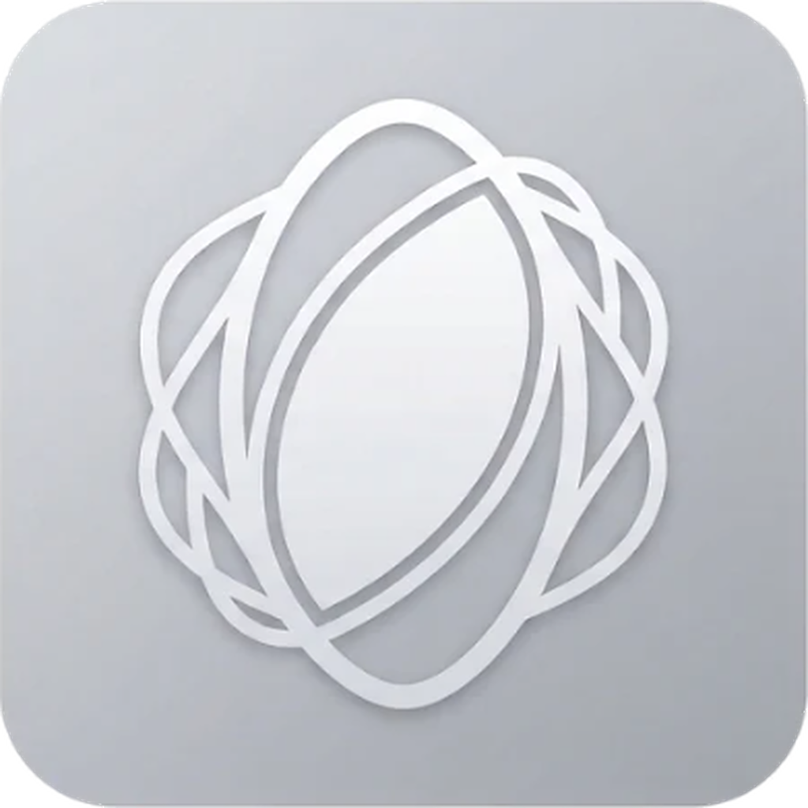

<h1 align="center">Silk - A Password Manager for Larpers</h1>

<p align="center">
  
</p>

**Silk is an offline-first password manager for Android, written in Rust.**

It securely stores your passwords, generates strong passwords, fills login forms automatically, and generates two-factor authentication codes (TOTP).

You can also enable optional cloud sync to keep your vault backed up across devices. Your vault is encrypted before it leaves your device, so Supabase only stores encrypted data.

> **Previously known as PassVault**
>
> PassVault has been renamed to Silk. The rename covers the crates, libraries, Android package, application ID (`app.silk`), classes, and documentation.
>
> The old `.pvlt` file format is intentionally preserved so existing vaults and backups remain compatible.
>
> **Coming from PassVault?** Android treats Silk as a separate app because its application ID changed. Back up your vault from PassVault, install Silk, then choose **Restore from backup** on Silk's first screen.
>
> See [docs/ARCHITECTURE.md](docs/ARCHITECTURE.md) for migration details.

---

## Features

- **Offline-first password storage** — Your vault stays on your device and can be unlocked without an internet connection.
- **Strong encryption** — Your vault is protected using Argon2id and AES-256-GCM.
- **Optional key file** — Add another layer of protection using a file that only you have.
- **Android autofill** — Fill usernames and passwords directly into supported apps and websites.
- **Built-in authenticator** — Generate time-based one-time passwords (TOTP) without needing a separate authenticator app.
- **Password generator** — Create strong, customizable passwords.
- **Cloud sync** — Optionally synchronize your encrypted vault using Supabase.
- **Proton Pass import and export** — Move your existing passwords between Silk and Proton Pass.
- **Brave and Chrome extension** — Use a read-only copy of your vault in a Chromium-based browser.

## Getting started

### Restoring an existing vault

To move from an older PassVault installation:

1. Open PassVault and create a backup using its backup feature.
2. Install Silk.
3. On Silk's first screen, select **Restore from backup**.
4. Choose your existing `.silk` or `.pvlt` backup.
5. Unlock your vault using your existing master password and key file, if one is required.

Your old vault does not need to be manually converted beforehand.

### Enabling Android autofill

1. Open Silk and tap **Turn on**.
2. Select Silk as your autofill service.
3. On devices where the setting is not opened automatically, navigate to:

   **Settings → Passwords & autofill → Autofill service → Silk**

For Chrome, you may also need to enable:

**Chrome → Settings → Autofill services → Autofill using another service**

When a matching login is found, Silk offers it in the autofill dropdown. If your vault is locked, selecting Silk opens a small unlock screen and returns the login to the app you were using.

### Understanding website and app matching

Silk uses the **Website or app** field in each login entry to determine where a credential should be offered.

Examples:

- Website: `https://example.com`
- Android app: `androidapp://com.example.app`

Website subdomains are also matched. For example, a login saved for `example.com` can match `login.example.com`.

---

## Using Silk

Silk has four main tabs:

| Tab | Purpose |
|---|---|
| **Logins** | View and manage your saved credentials. |
| **Codes** | Generate and manage one-time authentication codes. |
| **Generator** | Create strong passwords using your preferred settings. |
| **More** | Access backups, cloud sync, imports, exports, and other settings. |

### Password generator

The **Generator** tab lets you customize the passwords Silk creates.

You can choose:

- Password length, from 8 to 64 characters.
- Whether to include lowercase letters, uppercase letters, numbers, and symbols.
- Whether to exclude easily confused characters, such as `l`, `I`, `1`, `O`, `0`, and `o`.
- Whether new logins should automatically start with a generated password.

Silk guarantees that every selected character set appears in the generated password.

Your preferences are saved in `settings.json` inside the app's private storage. This file contains settings, not passwords or other vault secrets.

The **Generate** option in the login form uses these same preferences.

### Built-in authenticator

The **Codes** tab is Silk's built-in authenticator.

It lists your saved logins that have a one-time password configured. Each entry displays its current code and countdown.

You can:

- Tap a code to copy it.
- Select **Edit** to open its associated login.
- Select **Add** to configure another authenticator.

To add an authenticator, provide either a Base32 setup key or an `otpauth://` link. The authenticator is saved as its own entry.

Silk supports:

- SHA-1, SHA-256, and SHA-512.
- 6 to 8 digits.
- Custom time periods.
- RFC 6238-compatible TOTP generation, tested against the RFC test vectors.

**QR scanning is not supported yet.** For now, copy the setup key displayed by the service next to its QR code and paste it into Silk.

### Importing and exporting passwords

Silk supports importing and exporting password data to make switching password managers easier.

#### Importing from Proton Pass

Go to **More → Import from Proton Pass**.

Supported formats:

- `.json` exports.
- `.zip` exports containing `Data.json`.
- `.csv` exports.

The export must be unencrypted.

Silk imports logins, notes, aliases, and cards. Cards and other non-login items are stored as entries with their fields in the notes.

A few limitations apply:

- Items in Proton Pass's trash are skipped.
- Passkeys cannot be transferred.
- Existing logins are skipped when their title, username, website, and password all match.
- Other CSV files using common columns such as `name`, `url`, `username`, `password`, `note`, and `totp` are also supported, including Bitwarden exports.

#### Exporting for Proton Pass

Go to **More → Export for Proton Pass**.

Silk can export your vault as CSV or JSON using Proton Pass's column layout.

> **Important: Exported files are not encrypted.**
>
> Silk asks for confirmation before exporting and reminds you to delete the exported file after importing it into another password manager. Treat exported files like plain-text copies of your passwords.

Encrypted PGP Proton Pass exports are not supported. Export your data again without encryption before importing it into Silk.

**Compatibility note:** The JSON layout is reconstructed from Proton's documented export format rather than a file tested against a real Proton Pass account. If Proton Pass rejects the JSON export, use CSV instead.

### Backups and restoration

Silk provides encrypted backups so you can preserve your vault or move it to another device.

From the login list, use **Back up** to create a `.silk` backup containing:

- Your encrypted key slot.
- Your encrypted vault file.

The backup is kept up to date after every change.

The **Restore from backup** option is available on the create screen. It also accepts older `.pvlt` backups.

Keep a separate copy of your backup somewhere safe. A backup stored only on your phone will not protect you if the phone is lost or damaged.

---

## Security and privacy

Silk is designed so that your passwords remain encrypted even when you use cloud storage.

### How your vault is encrypted

Silk uses a technique called *envelope encryption*. Instead of encrypting your entire vault directly with your master password, it creates a separate random encryption key called a **Vault Encryption Key (VEK)**.

The process works like this:

1. **Your master password is processed.** Silk first hashes the password input with SHA-256, then uses Argon2id to derive a 256-bit key.
2. **The derived key protects the VEK.** The random VEK is stored in an encrypted key slot alongside the vault.
3. **The VEK encrypts your vault.** Silk uses AES-256-GCM to encrypt the actual vault data.
4. **Unlocking reverses the process.** Silk derives the key again, uses it to unwrap the VEK, and then uses the VEK to decrypt the vault.

The default Argon2id settings are:

| Setting | Value |
|---|---:|
| Time cost | 3 |
| Memory cost | 64 MiB |
| Parallelism | 4 |
| Derived key size | 256 bits |

A fresh random nonce is generated every time the vault is saved. Important vault headers, including the KDF settings, salt, and revision, are authenticated as well.

**Changing your master password does not require encrypting the entire vault again.** Silk simply re-wraps the existing VEK with a key derived from your new password.

### Rollback protection

Silk tracks an authenticated revision number for the vault.

Every save increases that number, and the device remembers the highest revision it has seen. This helps prevent an older copy of the vault from silently replacing a newer one.

Cloud downloads also pass through this rollback protection.

### Using a key file

You can optionally require a key file in addition to your master password.

A key file can be any file you select, or one generated by Silk itself.

A Silk-generated key file contains a random 64-byte secret and uses the `SKEY` magic identifier. This secret is mixed into the key derivation process, meaning the vault cannot be unlocked without the required key file.

Silk remembers the location of your key file, but not its contents.

**Keep a separate copy of your key file somewhere safe.** Losing your master password or required key file means losing access to your vault.

Older 64-byte Silk key files remain compatible.

### Cloud sign-in and the Silk key file

When you sign in to your Supabase account, Silk can save your cloud session in a Silk-generated key file.

The saved information includes:

- Your account email.
- Your Supabase user ID.
- Your refresh token.

**Your Supabase account password is never stored in the key file.**

The cloud session information is written after the key file's 64-byte secret. Only that original secret is used for key derivation, so adding or removing cloud sign-in information does not change your vault encryption key.

When you sign out or your session expires, Silk removes the saved cloud sign-in information.

If you use a regular file of your own instead of a Silk-generated key file, Silk cannot write session information into it. In that case, your cloud sign-in lasts only until Silk closes.

### Important: Key file protection is still planned

**Planned:** Silk will eventually support encrypting its `.key` file inside a `.skln` archive. This depends on the security update planned for Kiln, the separate archiving project that will provide Silk's future archive format.

Until that feature is implemented, the key file is stored unencrypted wherever you save it. This includes any cloud refresh token stored inside it.

Treat this file like a password. Anyone who gets a copy may be able to access your Supabase account, although they still cannot decrypt your vault without the required master password.

### Additional privacy protections

Silk also uses several Android-specific protections:

- Vault data stays in app-private storage.
- Android backup is disabled with `allowBackup=false`.
- Screenshots are blocked.
- Clipboard contents are marked sensitive and cleared after five minutes.
- Keys and decrypted entries are zeroized when the vault locks.

The vault automatically locks:

- After five minutes of inactivity.
- When the screen turns off.
- When you leave the app using the Back button.

Developers can adjust the default encryption settings in `core/src/vault.rs` (`Kdf::default`) and the idle timeout in `core/src/session.rs`.

---

## Optional cloud sync

Cloud sync lets you keep an encrypted copy of your vault in Supabase Storage.

It is optional and disabled until you configure a Supabase project and sign in through **More → Cloud sync**.

### How it works

1. Your vault is encrypted locally using its VEK.
2. After a change is saved, Silk uploads the encrypted key slot and vault file.
3. When you select **Sync now**, Silk checks for a newer cloud copy and downloads it when appropriate.
4. The downloaded vault passes through the same rollback protection used by local vaults.

The device always unlocks its own local copy. You do not need an internet connection to access your passwords.

The cloud only receives encrypted files. Supabase does not receive your master password or the decrypted contents of your vault.

### Handling different vault versions

Silk compares authenticated revision numbers to determine which copy is newer.

If two vaults have never been linked, Silk will not silently overwrite one with the other. Instead, it asks you which vault to keep.

This helps prevent accidental data loss when setting up cloud sync with separate vaults.

### Network restrictions

The only network-related Android code is `android/.../Net.java`.

It restricts HTTPS connections to your configured Supabase project host. Silk does not use this component to connect to arbitrary external hosts.

Storage access policies are defined in:

`supabase/storage-policies.sql`

### Setting up cloud sync

Cloud sync requires your own Supabase project and its corresponding configuration.

For setup instructions, authentication details, and storage policy configuration, see the **Setting up the cloud** section in [docs/ARCHITECTURE.md](docs/ARCHITECTURE.md).

---

## Brave and Chrome extension

Silk includes a Manifest V3 browser extension for Brave and other Chromium-based browsers.

The extension lets you use a **read-only copy** of your phone's vault on your computer.

It can:

- Suggest logins for the website you're visiting.
- Fill usernames and passwords when you select **Fill**.
- Fill or copy one-time authentication codes.
- Lock automatically after five minutes of inactivity.
- Ask for confirmation before filling credentials on a website that does not match the login's saved address.

### Installing the extension

**1. Create a vault backup**

On your phone, open Silk and select:

**More → Back up vault**

Move the resulting `.silk` file to your computer.

**2. Load the extension in Brave**

1. Open `brave://extensions`.
2. Enable **Developer mode**.
3. Select **Load unpacked**.
4. Choose the `browser-extension/` folder.

You can also extract the `silk-brave-extension` artifact from the GitHub Actions build and load that folder instead.

**3. Unlock your vault**

1. Click the Silk extension icon.
2. Select your `.silk` backup. Older `.pvlt` backups are also supported.
3. Enter your master password.
4. Provide your key file if your vault requires one.

The extension uses the same backup format as the Android app. It unwraps the VEK using Argon2id and decrypts the vault using AES-256-GCM. It has its own JavaScript Argon2 implementation, so unlocking takes a few seconds.

### Extension security

The extension only requests these permissions:

- `storage`
- `alarms`
- `activeTab`
- `scripting`

It can interact with a webpage only when you click **Fill**.

The encrypted backup is kept in extension-local storage. Decrypted login data stays in session storage, which the browser does not write to disk.

The extension does not modify your original vault. To update its copy, create another backup in Silk and load that backup into the extension.

**Limitations:**

- The extension does not synchronize changes back to your phone.
- It does not clear your clipboard automatically.
- JavaScript cannot reliably wipe sensitive data from memory.

### Running extension tests

From the project directory:

```bash
cd browser-extension
npm test
```

Tests cover:

- Argon2 against the RFC 9106 test vectors.
- Opening current backups and older vault files.
- RFC 6238 TOTP generation.
- Website matching.

Requires Node.js 18 or newer.

---

## For developers

The following sections cover Silk's architecture, development environment, and release process.

### Project structure

Silk is primarily written in Rust, with a small Java layer for Android-specific functionality.

| Directory | Technology | Responsibility |
|---|---|---|
| `core/` | Rust (`silk-core`) | Encryption, key slots, vault format, key files, TOTP, autofill matching, sessions, and idle locking. |
| `app/` | Rust | Slint UI and JNI bridge. Builds into `libsilk.so`. |
| `android/` | Java | Android-specific integrations, including `AutofillService`, document-picker callbacks, clipboard handling, and autofill result delivery. |
| `browser-extension/` | JavaScript | Manifest V3 extension for Chromium-based browsers. |

The core library contains no Android-specific code and can be tested on a regular development machine.

The Java layer is intentionally small (approximately 450 lines, mostly comments and boilerplate). It handles the Android APIs Rust cannot directly provide and passes strings and bytes to the Rust implementation. It does not contain vault logic.

### Cloud architecture: VEK, Kiln, and Supabase

Silk uses envelope encryption with Supabase Auth and Supabase Storage.

The master password derives a key that protects the VEK. The VEK then encrypts the vault archive.

In the planned final architecture, the archive will use Kiln's `.skln` format. Kiln is a separate project, and `.skln` support is not implemented in Kiln yet.

For now, `core/src/interim.rs` provides the temporary archive implementation behind the `Archiver` trait. This allows Silk to use the future archive interface without depending on the unfinished `.skln` format.

The architecture diagram, file formats, key file layout, `.skln` requirements, and remaining implementation tasks are documented in [docs/ARCHITECTURE.md](docs/ARCHITECTURE.md).

### Building Silk

#### Requirements

- Rust toolchain.
- Android SDK and NDK.
- JDK 17.
- Gradle 8.9.
- `cargo-ndk`.

Slint's Android backend compiles a small Java helper during the build, so `ANDROID_HOME` and a working JDK must be configured.

#### Build commands

Run the core tests:

```bash
cargo test -p silk-core
```

Run the browser extension tests:

```bash
cd browser-extension
npm test
```

Install the Android Rust targets:

```bash
rustup target add aarch64-linux-android x86_64-linux-android
```

Install `cargo-ndk`:

```bash
cargo install cargo-ndk
```

Build the Android native libraries:

```bash
cargo ndk --platform 26 -t arm64-v8a -t x86_64 -o android/app/src/main/jniLibs build --release --package silk
```

Build the Android debug APK:

```bash
gradle -p android assembleDebug
```

**Remember to commit `Cargo.lock` after the first successful build.**

---

## GitHub Actions and releases

The Android workflow is located at:

`.github/workflows/android.yml`

It supports the following triggers:

| Trigger | Workflow |
|---|---|
| Push to `main` | Runs core tests and builds Android. |
| Pull request | Runs core tests and builds Android. |
| Manual workflow run | Runs core tests and builds Android. |
| Version tag such as `v1.0.0` | Runs the regular workflow, then builds a signed release APK and AAB and attaches them to a GitHub Release. |

Debug APKs are uploaded as GitHub Actions artifacts.

### Configuring release signing

Before creating a release tag, generate a signing key:

```bash
keytool -genkeypair -v -keystore release.jks -alias silk -keyalg RSA -keysize 4096 -validity 10000
```

On Linux or Git Bash, encode the keystore:

```bash
base64 -w0 release.jks
```

Add the resulting value and the signing credentials under:

**GitHub → Repository Settings → Secrets and variables → Actions**

The required repository secrets are:

| Secret | Value |
|---|---|
| `KEYSTORE_BASE64` | Base64-encoded `release.jks` |
| `KEYSTORE_PASSWORD` | Keystore password |
| `KEY_ALIAS` | `silk` |
| `KEY_PASSWORD` | Key password |

Create and push a version tag:

```bash
git tag v1.0.0
git push --tags
```

> **Important:** Keep a secure backup of `release.jks`. Without the original signing key, you cannot publish updates as the same Android application.

---

## Planned features

The following features are not implemented yet:

- QR code scanning for authenticator setup.
- HOTP support.
- Passphrase generation.
- Saving new logins directly from other apps.
- KeePass import.
- Editing the vault through the browser extension.
- iOS app support.

An iOS version would require a separate Swift credential-provider extension and a macOS build runner.

---

## Contributing and project guidelines

Before making changes, read [`CLAUDE.md`](CLAUDE.md).

It contains the project guidelines for both human contributors and coding agents, including:

- How to hand work over between contributors and agents.
- What files and secrets must never be committed.
- Rules for adding dependencies.
- Practices that help keep the project small and maintainable.

Run the project bloat checks with:

```bash
scripts/check-bloat.sh
```

GitHub Actions also runs these checks in CI.

---

**Silk is built around one principle: your vault belongs to you.** It should remain usable offline, encrypted locally, and under your control, even when optional cloud services are enabled.
