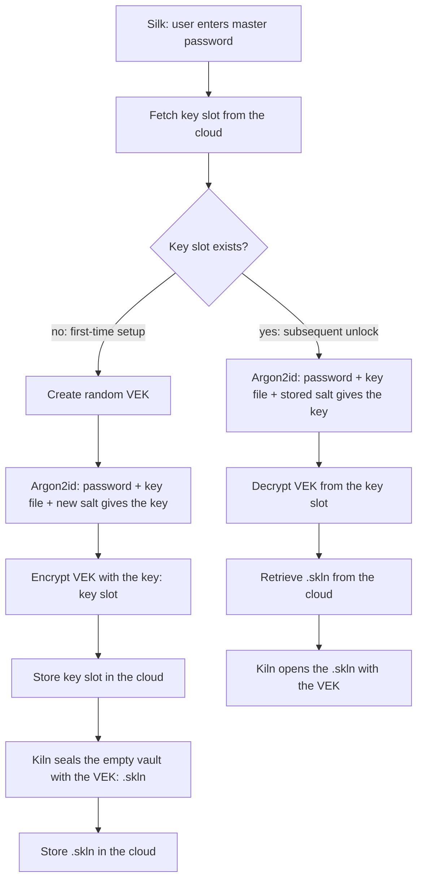

# Silk architecture: Silk, Kiln, VEK and Supabase

How Silk's pieces fit together: names, flow, file formats, cloud layout. Open work is listed at the bottom.

## Names

| Name | Meaning | Where it lives |
|---|---|---|
| **Silk** | This app: the password manager, formerly called PassVault. Master-password entry, unlock/save, the unlocked state in memory. | this repository |
| **Kiln** | A separate project: a multicore archiver with its own container formats. Silk uses only its small `kiln-skln` crate. | `kiln-rust` repository |
| **`.skln`** | Kiln's container for encrypted data (the `kiln-skln` crate, format in Kiln's `docs/FORMAT.md`). Silk stores its entries in one, keyed by the VEK, as `vault.skln`. | Kiln: `skln/`; Silk: `core/src/skln.rs` |
| **VEK** | Vault Encryption Key: 256 random bits, generated once at first-time setup. Encrypts the `.skln`. | in memory only; stored wrapped |
| **Key** | The Argon2id output (the diagram's "key"; KEK in code comments). Only ever wraps the VEK. | derived on demand, never stored |
| **Key slot** | The VEK encrypted by the key, plus the Argon2id settings and salt needed to re-derive it. 91 bytes. | `core/src/keyslot.rs` |
| **`Archiver`** | The seam between Silk and Kiln: a small trait for "seal entries with the VEK / open them again". | `core/src/archive.rs` |
| **Interim archive** | The stand-in that was used before `.skln` existed. **Not the `.skln` format**: different magic (`SKIM`) and object name (`vault.interim`). Read-only now: such a file still opens and is rewritten as `.skln` on unlock. | `core/src/interim.rs` |
| **Local store** | The on-device copy of the key slot and vault file in the app's private folder. It implements `RemoteStore`, so unlocking from the local copy runs the same flow as unlocking from the cloud does. Also holds the rollback mark. | `core/src/local.rs` |
| **Session** | The unlocked state the app holds (VEK + entries), idle lock, saves to the local store, backup and restore. | `core/src/session.rs` |
| **Backup** | One `.silk` file: key slot + vault file. | `core/src/backup.rs` |
| **Silk key file** | The `.key` file the app creates: a 64-byte secret (magic `SKEY`) plus the cloud sign-in that Silk saves after it automatically. Meant to be encrypted inside a `.skln` later (see "The key file"). | `core/src/keyfile.rs` |
| **Auth client** | Supabase Auth (email and password sign-up and sign-in, access tokens and their renewal), over HTTPS behind a one-method `Http` trait that the Java glue implements. | `core/src/auth.rs`, `android/.../Net.java` |
| **Supabase client** | Supabase Storage over the same `Http` trait: the two encrypted files per user, as a `RemoteStore`. Authenticated with the user's Supabase access token. | `core/src/supabase.rs` |
| **Sync** | Moves the key slot and vault file between the local store and the cloud by revision. | `core/src/sync.rs` |
| **Legacy vault** | The pre-key-slot `.pvlt` container (`PVLT` magic), where the Argon2id key encrypted the entries directly. Still read for migration and old backups. | `core/src/vault.rs` (`Vault`) |

## Flow



Saving: the archiver re-encrypts the entries with the VEK under a fresh nonce and revision + 1, then Silk stores the result.

Argon2id comes after the key-slot fetch, because the salt and cost settings are stored in the key slot. The `.skln` is encrypted with the VEK, not with the Argon2id key.

Changing the master password would re-wrap only the key slot and leave the vault file untouched. `CloudVault::change_credentials` does that, but only tests call it: the app has no screen for it yet (see Open work).

## The `.skln` dependency

`core/src/skln.rs` is the `Archiver` for Kiln's `.skln` and `archive::Current` points at it. It uses the `kiln-skln` crate (`skln/` in the Kiln repository, edition 2021, depending on `chacha20poly1305`, `hkdf`, `sha2`, `getrandom` and `zeroize`): raw-key seal and open on bytes, no paths or temp files, an authenticated revision in the plain header, and the member bundle Silk keeps its entries in. The vault file is ChaCha20-Poly1305; the key slot stays AES-256-GCM. The crate adds five crates to `silk-core` (see `MAX_CORE_CRATES` in `scripts/check-bloat.sh`). `browser-extension/src/skln.js` reads the same format in JavaScript. `interim.rs` stays as a read-only source for vaults written before `.skln` (see Known limits).

## Formats

All integers are big-endian, except inside a `.skln`, which is little-endian like the rest of Kiln's formats.

```
key slot  "SKVK" | version u8 | flags u8 (bit0 = key file) | t u32 | memKiB u32 | p u8 | salt[16] | nonce[12] | AES-256-GCM(VEK) + tag[16]
          first 31 bytes are the associated data; total 91 bytes

skln      "\x89SKLN\r\n\x1a" | version u8 (1) | flags u8 | kind u8 (1 = bundle) | chunk_log2 u8 | revision u64 | salt[16]   (36 bytes)
          then records: len u32 | ChaCha20-Poly1305(chunk) + tag[16]. The file key is HKDF-SHA256(VEK, salt); the header is
          authenticated, so the revision cannot be changed unnoticed. Full layout: Kiln's docs/FORMAT.md
bundle    (the payload of a .skln, little-endian) count u32 | { name_len u16 | name | data_len u32 | data }*
          one member: "vault.json" = {"entries":[...]}  (same entry shape as the old vault)

interim   "SKIM" | version u8 | flags u8 | revision u64 | nonce[12] | AES-256-GCM(archive) + tag[16]       (read-only, see above)
archive   (inside a SKIM file, big-endian) count u32 | { name_len u16 | name | data_len u32 | data }*

backup    "SKBK" | version u8 | key slot[91] | vault file (the rest)

key file  "SKEY" | version u8 | secret[64] | login_len u32 | login JSON      (login part optional; see "The key file")
```

The browser extension reads the backup (`browser-extension/src/vault.js`) and, as before, old `.pvlt` files. It opens both kinds of vault file inside a backup: `.skln` (`src/skln.js`; `src/chacha.js` carries its own ChaCha20-Poly1305 because WebCrypto has none) and the interim `SKIM` kind of older backups.

Key derivation is unchanged from the old vault: `SHA-256(password)`, mixed with `SHA-256(key file material)` when a key file is used, then Argon2id (t=3, 64 MiB, p=4 by default) to 32 bytes. The material of a Silk key file is its 64-byte secret; the material of any other file is the whole file. Existing key files keep working.

## The key file

```
"SKEY" | version u8 | secret[64] | login_len u32 | login JSON (login_len bytes)
```

- **Two kinds of key file.** A *Silk key file* starts with `SKEY` and is what **Create a key file** on the unlock screen writes. Anything else is a *raw* key file (a file the user picked, or the plain 64-byte files older versions created): it is hashed whole, exactly as before, and Silk never writes into it.
- **Only the secret feeds Argon2id** (`keyfile::material`). The sign-in after it can be added, replaced or removed without changing the key, so saving a sign-in can never lock the vault.
- **The sign-in is saved automatically.** The JSON holds the cloud account's email, user id and refresh token. The account password is never stored; it is only sent to Supabase's sign-in call and zeroized right after. Silk writes the sign-in after signing in or up, rewrites it when Supabase rotates the refresh token (it does so on every renewal), and removes it on sign-out or when Supabase no longer accepts it. When a key file is loaded, its sign-in is traded for a fresh session (no password prompt) and a sync follows. If a key file without a sign-in is loaded while Silk is already signed in, the sign-in is saved into it.
- **Safe writes.** The Java side (`SilkActivity.saveKeyFile`) first checks that the file on disk still starts with the same magic, version and secret, and then rewrites only the bytes after them in place. The secret is never rewritten, so an interrupted write can damage at most the sign-in, which is read leniently (a damaged sign-in part means "not signed in", never an error).
- **Not encrypted yet.** Until the planned `.skln` wrapping exists, the key file is stored as it is. Whoever holds it can sign in to the cloud account and download the two ciphertext files; they still need the master password to open anything.
- **Planned: the `.key` inside a `.skln`.** The key file is meant to be encrypted inside a `.skln`. That is a later update, after the security update in Kiln, because the encryption engine for it is going to be built in Kiln. `keyfile.rs` keeps these bytes as they are on purpose, so the future layer can wrap the whole file unchanged. Nothing in Silk depends on it yet.

## On-device files

In the app's private folder (`core/src/local.rs`):

```
keyslot.skvk     the key slot
vault.skln       the vault file (Kiln's .skln)
vault.interim    a vault file from before .skln: read when there is no vault.skln, removed when the next save writes one
vault.pvlt       an old vault, only until the first unlock converts it
seen.rev         highest vault revision this device has seen
```

Silk reads and writes these through the same `RemoteStore` trait the Supabase store implements. A save writes the key slot (only if it changed), then the vault file, each through a temporary file and a rename.

**First unlock of an old vault.** If there is no key slot but a `vault.pvlt`, the master password opens the old file, a new VEK is drawn, the key slot and vault file are written, and only then is `vault.pvlt` removed. A wrong password changes nothing. Biometric unlock is switched off at that point, because the Keystore holds the old vault key, not the VEK; the user turns it on again.

**Restoring a backup** accepts a `.silk` bundle or an old `.pvlt` file (kept as `vault.pvlt` and converted on the next unlock). Restoring clears the rollback mark, because it is the one deliberate way to go back to an older vault.

## Cloud layout

Supabase signs the user in (Auth) and keeps the files (Storage). One private bucket, `silk-vaults`, one folder per signed-in user:

```
silk-vaults/vaults/<user id>/keyslot.skvk
silk-vaults/vaults/<user id>/vault.skln
```

```
Silk app --Supabase Auth--> access token --Authorization: Bearer--> Supabase Storage (private bucket)
```

**How access is decided.** The app signs in with email and password against the project's own Auth (`core/src/auth.rs`). The access token that comes back is Supabase's own (`role: authenticated`, `sub` = the user id), so there is no second identity provider and nothing to run on a server. The storage policies in `supabase/storage-policies.sql` compare the token's `sub` with the `<user id>` folder, so a user can only touch their own folder; they also allow only the three known file names and the bucket caps files at 20 MB. The app builds the path from the signed-in account only, never from a separately supplied id, and refuses a token whose `sub` is not that id before sending anything (`core/src/supabase.rs`). The Supabase **publishable** key only identifies the project; it grants nothing by itself. Secret and `service_role` keys are never put in the app, and `supabase::Config` refuses them.

Everything stored is ciphertext, so Supabase is treated as untrusted storage. Core only sees the `RemoteStore` trait (`core/src/remote.rs`: `get`, `put`, `delete`, `exists`); `core/src/supabase.rs` implements it over HTTPS. Uploads create a missing object with `POST` (which refuses to replace anything) and replace an existing one with `PUT`; an object that was just reported missing is never replaced, so a read that was hidden by a policy can't lead to an overwrite.

The device always unlocks from its local copy. `core/src/sync.rs` moves the two objects: after every save the app runs a *push* (upload when this device is ahead), and **More > Sync now** runs a full sync (the higher authenticated revision wins; a download goes through the rollback guard). Only one sync runs at a time; saves that happen meanwhile queue one more push. If the account and the device hold different vaults that were never linked, nothing is copied and the user picks *Keep this device's vault* or *Use the cloud vault*. A download locks the open vault, because what was in memory is stale.

The cloud account (who may download the files) and the master password (who can decrypt them) are separate. Anyone who can download the two files can try passwords offline, so Argon2id cost and password strength are what protect the vault if the account is compromised.

## Setting up the cloud

1. **Supabase** (Free plan). Create a project and a **private** bucket `silk-vaults`. Under **Authentication > Providers** keep **Email** enabled; turn **Confirm email** off if you want sign-up to sign in at once (with it on, a new account must open the confirmation mail first and then use Sign in). Then run `supabase/storage-policies.sql` in the SQL editor (part 1 reads, part 2 replaces the policies).
2. **Configure the app.** The Supabase values go into `android/local.properties`, which git ignores:

   ```
   SUPABASE_URL=https://<project-ref>.supabase.co
   SUPABASE_PUBLISHABLE_KEY=<the publishable key>
   ```

   (Keep any `sdk.dir=` line that is already there.) CI can pass the same two names as environment variables. `SUPABASE_URL` is the project URL; the `.../rest/v1` address the dashboard also shows is accepted and cut back to it. Only the **publishable** key belongs here; if the build is given a `sb_secret_...` or `service_role` key, the app refuses to use it.
3. Build. While either value is missing or still a `YOUR_` placeholder, the app shows "Cloud sync isn't set up" and stays offline.
4. In the app: **More > Cloud sync > Sign in or create account.** Use a Silk key file (create one on the unlock screen) so the sign-in is saved and the next start signs in by itself.
5. Run `powershell -ExecutionPolicy Bypass -File .\supabase\smoke-test.ps1` (read-only), then with `-Write` for an upload, replace and delete round trip, before trusting it with a real vault.

### One identity provider

Sign-in is Supabase Auth only. A third-party provider (Firebase was tried) needs a custom `role: authenticated` claim, which needs server-side code. Do not add another identity provider without a reason that outweighs a second service and a larger app.

## Known limits (by design, for now)

- **Rollback:** the revision is authenticated, and the device keeps the highest one it has seen (`seen.rev`). Unlock and biometric unlock refuse a vault file with a lower revision (`Error::Rollback`); every save raises the mark. A file downloaded from the cloud goes through the same check before it replaces the local one. The mark is a plain file: someone who can write the app's private folder can also replace the vault, so this is aimed at a malicious server, not at an attacker with device access.
- **No VEK rotation.** Changing the password would re-wrap the same VEK. Rotating it needs the key slot and the vault file to change together, which two separate uploads can't do atomically.
- **No merge.** Two devices saving from the same revision: sync reports a conflict and copies nothing; the next save on either device gets the next revision and then wins.
- **Upload order** is key slot first, then vault file, so a half-finished first-time setup leaves a slot without a vault file (accepted as an empty vault), never a vault file nobody can open.
- **Cloud sync is optional.** Without the Supabase values (`android/local.properties`) the app stays fully offline (it still declares `INTERNET`, but `Net.java` only accepts HTTPS to the one configured Supabase host, and nothing else).
- **The sign-in in the key file is not encrypted yet** (see "The key file").
- **Vaults written before `.skln` are converted on unlock.** A device that holds `vault.interim` (magic `SKIM`) opens it through `interim.rs`, which is now read-only, and the first unlock saves it again as `vault.skln` with the next revision, so the rollback mark stays valid, then removes `vault.interim`. A backup that embeds an interim vault file still restores and still opens in the extension. The cloud only accepts `vault.skln` now (the Storage policies no longer list `vault.interim`), so an interim copy left in a bucket is not read; sync has not been run against the live project yet (see Open work).

## Coming from PassVault

PassVault was renamed to Silk everywhere. Left on purpose: the `PVLT` magic and `.pvlt` extension (the app and extension still read them; new backups are `.silk`), and the file name `core/src/vault.rs`, which holds `Entry`, `Kdf` and the key derivation next to the legacy `Vault` struct.

`app.silk` is a different app to Android: it installs next to the old `app.passvault`, does not update it and cannot read its data. To move over, use Back up in the old app (it saves a `.pvlt` file), install Silk, choose Restore from backup on its first screen and unlock with the same master password; the vault is converted then. Biometric unlock and autofill have to be set up again in Silk.

## Open work

- **Run the Storage policies and `supabase/smoke-test.ps1`** against the real project (read-only, then `-Write`) before trusting sync with a real vault. Sync, the Supabase client and the policies are only tested against mocks, and the app is untested on a device.
- **Change password screen.** The core part exists (`CloudVault::change_credentials`); the UI does not.
- **VEK rotation** with an atomic commit of key slot and vault file. Needs more than two separate uploads.
- **Encrypt the `.key` file inside a `.skln`**, after the security update in Kiln (see "The key file").
